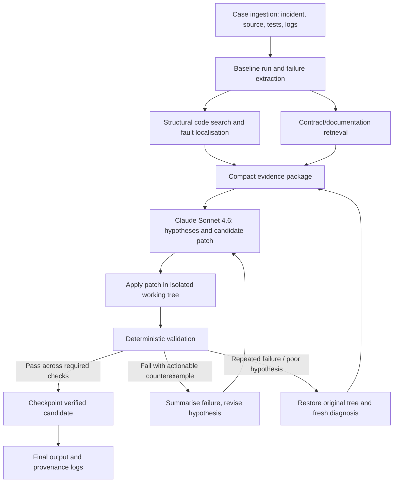

# C3 Take-Home: Autonomous Distributed-Systems Bug Fixer

## Requirements, architecture, repair strategies, validation, and implementation plan

**Purpose:** Build an agentic harness that autonomously diagnoses and repairs unfamiliar distributed-systems bugs, optimising primarily for successfully fixed cases and secondarily for execution time and engineering quality.

**Important limitation:** No method can guarantee finding and fixing every unseen bug. The practical goal is to maximise the probability of a correct repair under a strict runtime and model budget, and to demonstrate this empirically on practice cases.

**Verification note:** This document consolidates the C3 recruiter email and the approaches discussed in this conversation. The public repository could not be retrieved for independent verification during preparation. Treat the recruiter's email as authoritative; check numerical limits, entry points, interfaces, and evaluation specifics against the local [C3 README](https://github.com/c3-research/c3-take-home) before implementation. Do not rely on any unverified numerical limit below.

---

## 1. What C3 expects

Build a **fully autonomous fixer**, not a series of manually authored solutions. For each case, the harness should:

1. **Ingest the case:** Read the incident description, repository source, tests, logs, and other provided context.
2. **Investigate the failure:** Identify the violated invariant, examine relevant code paths, reconstruct the failure sequence, and form root-cause hypotheses.
3. **Retrieve contracts:** Search any supplied technical documentation for API guarantees, concurrency semantics, failure handling, and system invariants.
4. **Generate and apply a patch:** Use **Claude Sonnet 4.6** as the permitted runtime general-purpose language model.
5. **Validate automatically:** Run the supplied simulator/tests against the candidate patch, ideally with reproducible seeds and fault scenarios.
6. **Iterate without intervention:** Convert validation failures into concise counterexamples, diagnose and retry, and preserve the strongest validated candidate.
7. **Return the resulting patch/artifact:** Conform exactly to the README's required runtime protocol, output locations, and submission format.

### Evaluation priorities (from the recruiter email)

1. **Correctness:** Number of bugs repaired in **12 unseen cases**; they are **not** the supplied practice cases.
2. **Total runtime:** Time taken across the unseen cases.
3. **Tool quality:** Architecture, code quality, reliability, and ability to explain engineering decisions in the follow-up discussion.

At runtime the fixer may use **Claude Sonnet 4.6** and, optionally, **Jev** as a fast decision model. The development process may use other tools/models, subject to the README's rules. The recruiter estimates **2–3 hours** of work but allows more, with a **seven-day** deadline from the email.

### Deliverables (from the recruiter email)

- Fixer's **Docker image** and **source code**.
- **Build chat logs** from AI-assisted development.
- **Half-page write-up** describing the implementation and likely improvements.

Check the README for Docker architecture, image-size restrictions, API/proxy configuration, logging, the precise execution command, and submission mechanics. Keep API keys in environment variables or `.env`, **never** in Git, a Docker layer, reports, or chat-log submissions.

### Numerical constraints to verify against the README

The earlier discussion referred to the following, but they were **not independently verified here**:

| Previously mentioned parameter | Value to confirm |
|---|---:|
| Execution limit | 15 minutes per case |
| Model spending limit | $3 per case |
| Container resources | 2 CPUs and 4 GB RAM |
| Image size | Up to 4 GB |
| Architecture | `linux/amd64` |
| Simulation acceptance | 20 hidden seeds per case |
| Practice cases | Six |
| Documentation corpus | Roughly 26 million tokens |
| Network access | Restricted except the supplied model proxy |

The actual README takes precedence. Do not encode these values as constants until checked.

---

## 2. Central design principle

> **Use deterministic software for control and verification; use the language model for diagnosis and code generation.**

A complex multi-agent architecture is not automatically better than a small, well-instrumented repair loop. The strongest initial design is a **single Claude-based agent** with deterministic tools, selective retrieval, explicit budgets, reproducible testing, and rollback.

Research on **Agentless** supports taking simple localisation → repair → validation pipelines seriously; the point is not that Agentless guarantees success here, but that agent complexity must earn its cost through measured improvement.

### Proposed architecture



The **controller** owns state, deadlines, budget accounting, test order, rollback, checkpoints, and success criteria. Claude never needs to remember these correctly or decide whether to ignore them.

---

## 3. Ranked approaches

| Approach | Why it helps | Priority |
|---|---|---|
| **Failure-driven localisation** | Reduces context and patch search space | Critical |
| **Simulator-based counterexamples** | Reproduces and explains concurrency failures | Critical |
| **Contract-aware retrieval** | Avoids patches that violate undocumented semantics | Critical |
| **Iterative patch-and-test loop** | Converts failures into corrective evidence | Critical |
| **Rollback and best-candidate checkpoints** | Prevents deterioration after unsuccessful attempts | Critical |
| **Multiple seeds and regression tests** | Reduces test overfitting and catches regressions | High |
| **Independent diagnosis restart** | Escapes incorrect initial assumptions | High |
| **Additional candidate patches** | Provides alternatives when the first theory is wrong | High, budget-dependent |
| **Property/invariant testing** | Tests semantic correctness rather than symptoms | High, if simulator permits |
| **Parallel independent agents** | May add diversity but consumes time/compute/tokens | Experimental |
| **Vector database, large orchestration framework** | Useful only if simple retrieval/control is insufficient | Defer |

### 3.1 Failure-driven code localisation

**Do not send the full repository to Claude by default.** First run the baseline simulator/tests and create a compact diagnostic package containing:

- First violated invariant or assertion.
- Reproducible seed and scenario (if available).
- Relevant trace events leading to failure.
- Source files/functions appearing in stack traces, logs, or state-transition paths.
- Relevant callers, callees, state mutations, and synchronisation operations.
- Existing tests establishing expected behaviour.

Start with inexpensive tools (`ripgrep`, symbol indexes, simple call-site extraction, file slices). Widen the search only when the initial evidence does not explain the failure. A useful progression is **repository → file → function → edit location**.

**Benefits:** Less model latency/cost, fewer irrelevant edits, and more interpretable diagnoses. **Risk:** Over-aggressive filtering may hide the true cause; support an explicit widening step.

### 3.2 Contract-aware retrieval

Distributed-systems bugs often turn on guarantees that are easy to guess incorrectly: delivery semantics, ordering, idempotency, retries, ownership, crash recovery, timeouts, and consistency.

- Start with **lexical/BM25-style retrieval** using exact identifiers, APIs, exception names, error messages, and state variables.
- Retrieve small passages of the **actual contract**, ideally with file/section references.
- Put relevant contracts next to source slices in Claude's prompt; distinguish documented facts from model hypotheses.
- Add embeddings/semantic retrieval only if practice tests show lexical search routinely misses the necessary material.
- Cache indexed documentation and repeated search results if the rules and container environment allow it.

For very large documentation corpora, targeted retrieval is more useful than stuffing documentation into a massive prompt.

### 3.3 Deterministic reproduction and counterexamples

Before patching, determine whether the baseline failure can be reproduced. For each failure, store structured evidence:

```json
{
  "seed": 12345,
  "scenario": "worker_restart_during_retry",
  "violated_invariant": "request processed at most once",
  "first_bad_event": "second commit for request X",
  "suspect_functions": ["handle_retry", "commit_result"],
  "trace_excerpt": ["...relevant events only..."],
  "baseline_status": "failed"
}
```

The values above are **illustrative**, not a real C3 result.

Where permitted, investigate classes of fault such as:

- Dropped, duplicated, delayed, and reordered messages.
- Worker/process crashes, restarts, partial commits, and recovery.
- Races between state checks and updates; stale observations.
- Timeout/retry interactions, duplicate acknowledgements, and idempotency.
- Lock ownership, resource leaks, deadlock/livelock, inconsistent replication.

Retain the original failing seed and a minimal trace for every later regression check. Consider **delta debugging** to shorten very long reproductions, when simulator controls make this possible and the reduction cost is justified.

**Why:** FoundationDB's engineering documentation demonstrates the usefulness of deterministic simulation in surfacing and reproducing complex distributed failures. This inspires the method; it does not imply the C3 simulator has identical features.

### 3.4 Counterexample-guided patching

For each candidate patch:

1. Apply it in an isolated working tree or clean snapshot.
2. Perform syntax/build checks before expensive simulations.
3. Re-run the original failing seed(s).
4. Run existing regression tests.
5. Test additional seeds/scenarios if time permits.
6. Classify failures and return only actionable summaries to the model.
7. Keep the candidate only if it improves the validated result without regressions.

Avoid an unrestricted “keep trying” loop. Explicitly cap model calls, simulator runs, spending, and remaining time. Reserve enough budget to assess the final candidate.

### 3.5 Two different recovery modes

**Local revision:** The change appears promising but fails a new seed or one invariant. Give Claude the prior patch, exact counterexample, and request a minimal targeted correction.

**Fresh diagnosis:** The same approach fails repeatedly, introduces regressions, or does not address the root cause. Reset to the original source tree, preserve all observed evidence, and ask Claude to develop an **independent hypothesis** rather than iterating on the old patch. A possible initial trigger is every third unsuccessful attempt; tune empirically, not dogmatically.

Independent candidate development can use separate temporary worktrees. Parallelise only if measured success benefits exceed wall-clock, simulator contention, and extra inference costs.

### 3.6 Verification beyond one passing seed

Use distinct layers:

| Validation layer | Question |
|---|---|
| Original reproducer | Was the observed fault actually removed? |
| Existing regression tests | Did the fix break formerly correct behaviour? |
| Additional seed/fault testing | Does it generalise to related interleavings? |
| Invariant/property checks | Is the required semantic property still preserved? |

Avoid “fixes” that merely suppress an assertion, silence an exception, skip a test, or return a plausible constant. Require patches to preserve documented contracts.

Passing available tests does **not** prove semantic correctness; program-repair literature shows test-suite-overfitting is a real problem.

---

## 4. Harness tools and state

A small set of bounded, well-designed tools is preferable to unrestricted shell transcripts:

| Tool | Behaviour |
|---|---|
| `list_files(pattern)` | Find candidate files and their sizes |
| `search_code(query, limit)` | Return bounded matches with filenames and line numbers |
| `read_file(path, range)` | Read targeted, line-numbered code slices |
| `search_docs(query, limit)` | Return contract snippets with provenance |
| `apply_patch(diff)` | Apply guarded edits and report conflicts |
| `run_build()` | Catch parse/compile/import failures cheaply |
| `run_tests(seeds, timeout)` | Run isolated deterministic checks and return structured results |
| `checkpoint()` / `rollback()` | Preserve best candidate and restore clean state |

Put limits on outputs so a massive log cannot consume the entire context window.

Recommended controller state:

```text
case_id
baseline_failures + reproducible seeds
source_revision / clean snapshot
retrieved_contracts (with provenance)
hypotheses and previously attempted root causes
candidate patch history
per-candidate: build status, seed pass/fail, regressions
best_validated_patch
model_token_spend / dollar_spend
wall_clock_deadline
reserved_final_validation_budget
```

The model should return **structured diagnoses and patches**; the controller should verify and execute them. Avoid allowing the model to declare its own fix successful without tests.

---

## 5. Repair-loop pseudocode

```python
def repair_case(case, deadline, budget):
    baseline = inspect_and_test(case)
    contracts = retrieve_relevant_contracts(case, baseline)
    history = []
    best = None
    attempt = 0

    while within_limits(deadline, budget, reserve_for_validation=True):
        context = build_context(
            case=case,
            baseline=baseline,
            contracts=contracts,
            history=history,
            best_candidate=best,
        )

        # Periodically abandon the previous diagnosis entirely.
        fresh = attempt > 0 and attempt % 3 == 0
        candidate = generate_patch_with_claude(
            context=context,
            fresh_diagnosis=fresh,
        )
        attempt += 1

        if not patch_is_safe(candidate):
            history.append((candidate, "unsafe or invalid patch"))
            continue

        result = validate_in_isolated_tree(
            candidate,
            original_failures=baseline.failures,
            regression_tests=baseline.tests,
            additional_seeds=select_seeds(history),
        )
        history.append((candidate, result))

        # Regression-free acceptance is a necessary, not sufficient,
        # condition for an improvement.
        if result.regressions == 0 and better_than(candidate, best, result):
            best = checkpoint(candidate, result)

        if result.all_required_checks_passed:
            break

    return best
```

This is **design pseudocode**; actual names and I/O must match the challenge. In particular, `better_than` should prioritise preserving already-correct behaviour, resolving the target failure, and broader seed coverage. Never prefer a patch solely because it increases the raw count of passing tests by disabling important checks.

---

## 6. Runtime/cost optimisation

According to the recruiter, fixing more cases matters most. Optimise speed **without trading away verification correctness**.

Suggested **initial allocation**, not measurements or confirmed rules:

| Phase | Approximate share of per-case time |
|---|---:|
| Diagnosis and retrieval | 20% |
| Generate/revise candidate patch | 40% |
| Validation and regression | 30% |
| Finalisation reserve | 10% |

Tune from traces of actual runs. Track separate durations for retrieval, model latency, code changes, compilation, simulator runs, and retries. Prefer high-signal early tests; reserve broad seed tests for promising candidates.

Potential improvements, in order:

1. **Search before reading:** Reduce model input using line-numbered grep and targeted slices.
2. **Deduplicate evidence:** Avoid resending unchanged source or complete raw logs.
3. **Cache immutable context:** Reuse documentation and source indexes where permitted.
4. **Use staged validation:** Build → original seed → regressions → broader seed set.
5. **Escalate intelligently:** Retry locally when failure indicates a small correction; restart diagnosis when the fundamental theory is wrong.
6. **Bound exploration:** Deadline-aware limits and explicit validation reserves.
7. **Parallelise selectively:** Only when model and simulator contention do not negate the advantage.
8. **Consider Jev later:** Introduce it only after measurement shows routing decisions are a material bottleneck and its accuracy is sufficient.

### Candidate stopping policy

- **Stop immediately** if runtime/spending limits force it, returning the strongest permissible validated patch.
- **Stop early** after a candidate passes all required checks *and* sufficient extra validation, if further exploration would risk the submission deadline.
- **Spend more effort** when failures are reproducible and there is a clear novel hypothesis.
- **Restart** after repetitive failures rather than accumulating an increasingly confused context.

A good controller differentiates **insufficient evidence**, **invalid patch**, **fixed original fault but new regression**, and **entirely different failure**.

---

## 7. Empirical experiments

Do not choose an elaborate design on intuition alone. Run an ablation study over the practice cases using the **same baseline test seeds** for comparable measurements, then verify final choices with separate, previously unused seeds.

| Configuration | Components | Main hypothesis tested |
|---|---|---|
| **A** | One-shot Claude patch | Establish basic baseline |
| **B** | A + targeted code/contract retrieval | Determine value of localisation |
| **C** | B + iterative simulator feedback | Determine value of counterexample-driven retries |
| **D** | C + independent diagnosis restart | Determine value of escaping bad hypotheses |

Metrics:

- Number/percentage of practice cases completely fixed.
- Time per case and aggregate time.
- Model spend/tokens per case.
- Model calls and candidate patches attempted.
- Regression rate and original-failure resolution rate.
- Pass rate on **held-out** seeds / different fault schedules.
- Failure classifications: retrieval miss, wrong root cause, syntactically invalid patch, incomplete patch, semantic regression, timeout, budget exhaustion.

Repeat runs where practical, especially if model outputs are stochastic. Examine the marginal improvement from each added component relative to its additional time/cost.

**Avoid tuning to the exact practice cases:** Use them to expose general weaknesses in retrieval, tools and test policies, not to teach the harness special-case fixes that will fail on unseen repositories.

---

## 8. Practical implementation order

### MVP (aim for the recruiter's 2–3 hour expectation)

1. Confirm the exact README protocol and all constraints; execute a provided minimal example end-to-end.
2. Build a straightforward Python controller and structured tool interface.
3. Run baseline tests; capture and summarise first failures.
4. Implement source search/read and relevant documentation retrieval.
5. Prompt Claude for root cause and a minimal patch grounded in source and contracts.
6. Apply patch in a clean snapshot, compile/test, and feed back counterexamples.
7. Add retries, hard time/cost limits, logging and last-good checkpoint.
8. Test on all available practice cases; record success/time and inspect failure modes.

**MVP target: Configuration C** (localise → patch → validate → iterate).

### First improvements if time remains

- Independent fresh-diagnosis retry (Configuration D).
- Multiple reproducible seeds, explicit invariants and regression preservation.
- Better trace summarisation and context selection.
- Failure classification and adaptive seed selection.
- Measured cache and parallel-candidate optimisations.

### Defer until supported by evidence

- Multi-agent debates/swarm orchestration.
- Expensive embedding/vector infrastructure.
- Extensive custom model checking or complex static-analysis frameworks.
- Jev-based model routing when no latency bottleneck has been demonstrated.

These are not necessarily bad ideas; they are simply harder to justify in a constrained take-home unless a simpler harness demonstrably fails in a way they solve.

---

## 9. Prompt design

Prompts should require evidence and constrain the model's changes. An illustrative diagnosis-and-patch contract:

```text
You are diagnosing a distributed-systems correctness failure.

Inputs:
- Incident description and observed invariant failure
- Reproducible failing seed and condensed event trace
- Relevant source slices with file paths and line numbers
- Retrieved system/API contracts with references
- Prior candidate attempts and their observed outcomes (if any)

Tasks:
1. State the violated behavioural invariant.
2. Identify the smallest plausible root cause and cite code evidence.
3. Explain how the event sequence triggers the defect.
4. Propose the minimal corrective change consistent with contracts.
5. Predict which existing behaviours might regress.
6. Return a machine-applicable patch; avoid unrelated refactoring.

Do not:
- Suppress tests or assertions to fake success.
- Assume undocumented guarantees.
- Claim the patch passes before the harness executes tests.

If evidence is inadequate, request a specific code slice, contract, or test
instead of inventing a root cause.
```

The repair prompt should receive the **exact new counterexample** and a **concise summary of attempted fixes**. On fresh-diagnosis restarts, suppress anchoring to the previous theory while retaining the objective failure evidence.

---

## 10. Engineering and submission quality

Design for maintainability and explanation during the technical follow-up:

- **Small state machine**, with explicit states such as `INGEST`, `LOCALISE`, `PATCH`, `VALIDATE`, `REVISE`, `FINALISE`.
- **Reproducibility:** Log case ID, seed, source revision, model configuration, prompt version, tool calls, outcomes and timings.
- **Isolation:** Validate candidate patches in separate clean trees/containers as supported.
- **Safety:** Limit allowed file paths; reject edits to test harness or evaluation machinery; enforce subprocess timeouts.
- **Graceful failure:** Return a valid result on model errors, malformed patches, simulator crashes, exhausted budgets and timeouts.
- **Observability:** Log enough for diagnosis but not unbounded traces or secrets.
- **Minimal dependencies:** Optimise startup and reduce hidden-environment failures.

### Half-page write-up outline

1. **Design:** One reasoning model with deterministic search, patch, simulator and rollback tools.
2. **Approach:** Baseline reproduction, contract-aware localisation, candidate generation, staged validation and counterexample-driven retries.
3. **Efficiency:** Bounded context, staged tests, time/cost guards and best-candidate preservation.
4. **Evidence:** Practice cases fixed, average/worst-case runtime and principal limitations.
5. **Next steps:** Independent diagnosis, stronger invariant-based testing and adaptive budgets (if not already implemented).

### Submission checklist

- [ ] Source and Dockerfile included; image builds for the required platform.
- [ ] Entrypoint/I/O conforms to the README.
- [ ] Runtime uses only permitted models and network endpoints.
- [ ] No credentials embedded in files, image layers, logs or source control.
- [ ] Every practice case exercised end-to-end through the Docker image.
- [ ] Hard caps and graceful fallback implemented.
- [ ] AI development chat logs collected and checked for secrets.
- [ ] Half-page write-up and reproduction instructions included.

---

## 11. Relevant research and reading

The papers and engineering material below motivate particular techniques; results obtained on SWE-bench or another repair benchmark are **not** directly transferable performance guarantees for C3's unseen distributed-systems cases.

1. **Agentless: Demystifying LLM-based Software Engineering Agents** — strong argument for progressive localisation, patch generation and validation before adding more autonomy.  
   https://arxiv.org/abs/2407.01489
2. **SWE-agent: Agent-Computer Interfaces Enable Automated Software Engineering** — tool/interface design for file navigation, editing and testing.  
   https://arxiv.org/abs/2405.15793
3. **AutoCodeRover: Autonomous Program Improvement** — structural code search and automated fault localisation for repair tasks.  
   https://arxiv.org/abs/2404.05427
4. **FoundationDB: Testing and Simulation** — deterministic simulation and reproducible distributed-systems testing.  
   https://apple.github.io/foundationdb/testing.html
5. **Delta Debugging** — reducing failure-inducing inputs or event sequences; see Andreas Zeller's work, including *Simplifying and Isolating Failure-Inducing Input*.  
   https://www.st.cs.uni-saarland.de/dd/
6. **Test-suite overfitting in automated program repair** — reminder that passing tests is not the same as a semantically correct fix; see the general literature on patch correctness and overfitting.  
   https://arxiv.org/search/?query=automated+program+repair+test+suite+overfitting&searchtype=all

Challenge repository: https://github.com/c3-research/c3-take-home

---

## 12. Final recommendation

**Build one evidence-driven Claude harness, not a swarm of loosely coordinated agents.** The highest-value loop is:

**Reproduce → locate → retrieve contract → diagnose → patch → run simulator → extract counterexample → revise or restart → retain best verified patch.**

Prioritise correctness, regression preservation and independent validation. Then optimise source/doc retrieval, trace compression, test ordering, and decision latency using measured practice-case data. The biggest likely advantage is **the quality of the execution-feedback loop**, not the number of agents or the size of the prompt.
